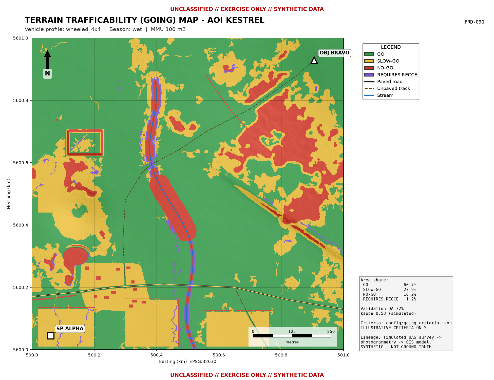

# Rapid Terrain Mapping & Terrain Trafficability (GOING) Analysis using UAS/C-UAS and GIS

**UNCLASSIFIED // EXERCISE ONLY // SYNTHETIC DATA**

Exercise **TERRA SWIFT**, area of interest **AOI KESTREL** (notional, 1 km²). This is a fully
software-based, repeatable demonstration of how UAS-derived geospatial data and GIS tools produce
a validated terrain-trafficability (GOING) product. It covers survey planning, photogrammetry
products, the GIS terrain database, the four-class GOING model, route comparison, validation,
automation and operational documentation.



## Start here

| If you want to... | Read / run |
|---|---|
| Understand the whole project (architecture, tools, workflow, demo plan, assessment, presentation) | [`docs/00_PROJECT_BLUEPRINT.md`](docs/00_PROJECT_BLUEPRINT.md) |
| See the results | [`outputs/maps/`](outputs/maps), [`outputs/qgis_layouts/`](outputs/qgis_layouts), [`outputs/reports/`](outputs/reports) |
| Brief a commander | [`presentation/Operator_Briefing_AOI_KESTREL.pptx`](presentation/Operator_Briefing_AOI_KESTREL.pptx) (17 slides with speaker notes) |
| Open the GIS project | `outputs/AOI_KESTREL_GOING.qgz` in QGIS 3.34 LTR or later |
| Rebuild everything | [Quick start](#quick-start) below |

## What is real and what is simulated

| Element | Status |
|---|---|
| Survey design maths, flight lines, GCP layout, QGroundControl `.plan` files | **Demonstrated** (real calculations; not flown) |
| UAS imagery and photogrammetric products (ortho, DSM, DTM) | **Simulated**: synthetic terrain degraded with realistic SfM errors. The real processing procedure (WebODM/ODM) is documented. |
| GIS terrain database, slope, hydrology, vegetation structure, obstacles | **Demonstrated** on the simulated products |
| GOING classification (Python reference and QGIS processing model) | **Demonstrated**. The criteria are **illustrative**. |
| Route comparison and line of sight | **Demonstrated**. The vehicle speeds are **illustrative**. |
| Validation | **Method demonstrated**. The ground observations are **simulated** from a hidden truth model. |
| Map production, metadata, automation, SOPs | **Demonstrated** |

## Repository layout

```
terrain-going-analysis/
├── run_pipeline.py              # one-command reference pipeline (all products)
├── config/
│   ├── project.json             # AOI grid/CRS, seed, nominated points, OP, validation design
│   └── going_criteria.json      # vehicle profiles x seasons, thresholds, route weights
├── src/going/                   # Python package
│   ├── synth.py                 # synthetic ground-truth world (terrain, land cover, hidden soil state)
│   ├── survey.py                # GSD/overlap design, flight lines, GCPs, QGroundControl .plan export
│   ├── uas.py                   # photogrammetry simulator (ortho, DSM, DTM, confidence, digitising)
│   ├── terrain.py               # slope, priority-flood hydrology, TWI, vegetation structure, VARI
│   ├── classify.py              # GOING rules (map) + truth classifier (validation)
│   ├── routes.py                # least-cost routes, metrics, weighted scoring, viewshed
│   ├── validate.py              # DEM check points, stratified sampling, confusion matrix, kappa
│   ├── carto.py / maps.py       # map-sheet template and 15 standard products
│   └── io.py                    # GeoTIFF/GeoPackage export, ISO 19115-style metadata
├── qgis/
│   ├── scripts/going_classify.py        # QGIS Processing algorithm (script:goingclassify)
│   ├── models/going_terrain_analysis.model3
│   ├── models/going_route_analysis.model3
│   ├── styles/*.qml                     # reusable layer styles
│   ├── build_models.py / run_models.py / build_project.py
│   └── qgis_env.py
├── presentation/
│   ├── build_briefing.py
│   ├── Operator_Briefing_AOI_KESTREL.pptx
│   └── assets/ (workflow + architecture diagrams)
├── docs/                        # blueprint, survey, photogrammetry, GIS method, SOP, metadata, seasonality, update, QA
└── outputs/                     # generated deliverables (committed for review)
    ├── rasters/   (ortho, DSM, DTM, CHM, slope, TWI, GOING x3, speed, viewshed ...)
    ├── vector/terrain_db.gpkg   (unified terrain database)
    ├── maps/      (15 PNG map products)
    ├── qgis_layouts/ (A3 PDF/PNG from QGIS)
    ├── qgis_model/   (outputs of the QGIS models + cross-check)
    ├── mission/      (QGroundControl .plan per sortie, survey_design.json)
    ├── reports/      (VALIDATION_REPORT.md, ROUTE_ASSESSMENT.md, CSV statistics, run log)
    ├── metadata/     (one JSON record per product + catalogue)
    └── AOI_KESTREL_GOING.qgz
```

## Quick start

Tested on Ubuntu 24.04 with Python 3.12 and QGIS 3.34.4 LTR. Windows and macOS work the same way
from the OSGeo4W Shell or the QGIS Python console.

```bash
cd terrain-going-analysis
python3 -m pip install -r requirements.txt

# 1. Reference pipeline: every product, report and map (about 20 s)
python3 run_pipeline.py                     # wheeled_4x4, wet season (defaults in config/project.json)
python3 run_pipeline.py --season dry --profile tracked --out outputs_tracked_dry   # variant

# 2. QGIS automation (uses the QGIS Python; PYTHONNOUSERSITE avoids pip/QGIS numpy clashes)
PYTHONNOUSERSITE=1 python3 qgis/build_models.py    # (re)writes the .model3 files, installs script + models
PYTHONNOUSERSITE=1 python3 qgis/run_models.py      # runs both models, cross-checks with the Python result
PYTHONNOUSERSITE=1 python3 qgis/build_project.py   # styled .qgz + A3 PDF layouts

# 3. Briefing deck (numbers read from outputs/reports)
python3 presentation/build_briefing.py
```

Headless batch run of the QGIS model (after the script is installed in the QGIS profile):

```bash
qgis_process run qgis/models/going_terrain_analysis.model3 -- \
  DTM=outputs/rasters/dtm.tif CHM=outputs/rasters/chm.tif CONFIDENCE=outputs/rasters/data_confidence.tif \
  TERRAIN_DB=outputs/vector/terrain_db.gpkg CRITERIA=config/going_criteria.json PROFILE=0 SEASON=1 \
  going_classification_raster=going.tif
```

In the QGIS desktop, open **Processing ▸ Toolbox ▸ Models ▸ Terrain analysis (GOING)**.

## Reference-run results (simulated, v1.0)

| Measure | Value |
|---|---|
| Survey design | GSD 2.67 cm, 80/70 % overlap, 28 lines, about 1,540 images, 3 sorties |
| DTM vertical accuracy (check points) | RMSEz 0.05 m non-vegetated; 0.65 m vegetated |
| GOING accuracy (150 determinate points) | OA 72 % (95 % CI 64-79 %), kappa 0.58, area-weighted OA 75 % |
| RECCE flag efficiency | 62 % of RECCE points proved SLOW-GO or NO-GO |
| QGIS model compared with the Python reference | 97.0 % cell agreement |
| Recommended route (illustrative weights) | C-ASSURED: 1.9 km, about 6 min, no unverified crossings |

The full analysis is in [`outputs/reports/VALIDATION_REPORT.md`](outputs/reports/VALIDATION_REPORT.md)
and [`outputs/reports/ROUTE_ASSESSMENT.md`](outputs/reports/ROUTE_ASSESSMENT.md).

## Documentation

| # | Document |
|---|---|
| 00 | [Project blueprint](docs/00_PROJECT_BLUEPRINT.md) |
| 01 | [UAS survey planning](docs/01_SURVEY_PLANNING.md) |
| 02 | [Photogrammetry processing](docs/02_PHOTOGRAMMETRY_PROCESSING.md) |
| 03 | [GIS integration & GOING classification method](docs/03_GIS_INTEGRATION_AND_CLASSIFICATION.md) |
| 04 | [SOP - UAS mapping mission planning & execution](docs/04_SOP_MISSION_PLANNING.md) |
| 05 | [GIS metadata standard](docs/05_GIS_METADATA_STANDARD.md) |
| 06 | [Terrain seasonality limitations](docs/06_TERRAIN_SEASONALITY.md) |
| 07 | [Map update procedure](docs/07_MAP_UPDATE_PROCEDURE.md) |
| 08 | [Data-quality checklist](docs/08_DATA_QUALITY_CHECKLIST.md) |

## Disclaimer

All data are synthetic and the coordinates are placeholders in EPSG:32630. They do not depict a real place.
The classification thresholds and speeds are illustrative teaching values, not doctrine or vehicle
data. Do not use these products for real movement planning.
