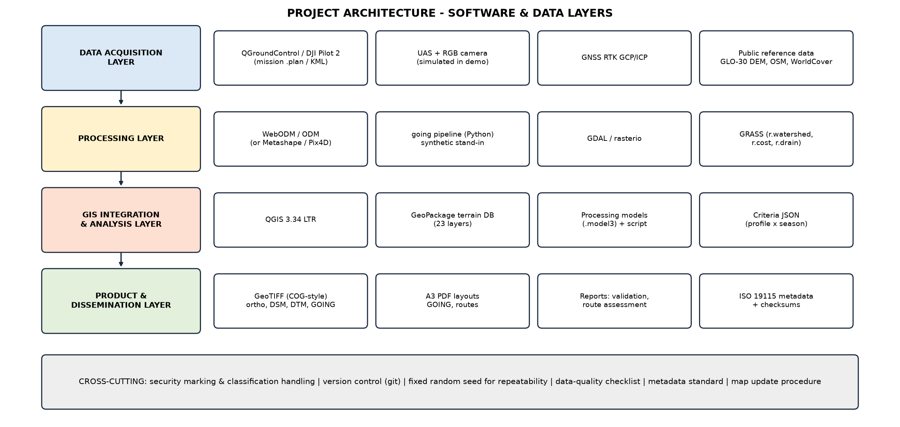
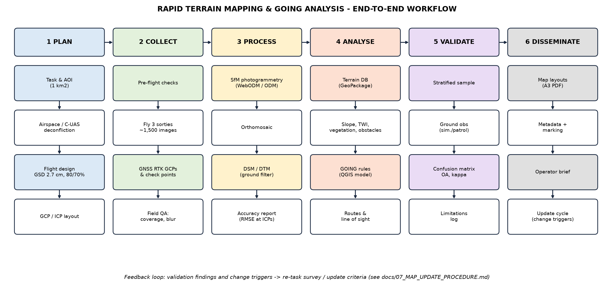
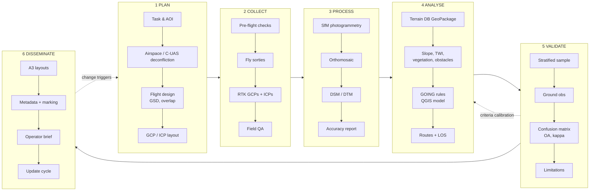

# PROJECT BLUEPRINT
## Rapid Terrain Mapping & Terrain Trafficability (GOING) Analysis using UAS/C-UAS and GIS Software

**UNCLASSIFIED // EXERCISE ONLY // SYNTHETIC DATA**

| Document control | |
|---|---|
| Project | Exercise TERRA SWIFT, AOI KESTREL (notional, 1 km²) |
| Document | Project blueprint (master document) |
| Version | 1.0 |
| Prepared by | Course Syndicate GEO-1, Geospatial Cell |
| Distribution | Course directing staff, syndicate members |
| Related | `README.md`, `docs/01` to `docs/08`, `outputs/reports/*`, briefing deck |

---

## 1. Executive summary (BLUF)

1. **Aim.** To demonstrate, entirely in software, how UAS-derived geospatial data and GIS tools can be
   combined to produce a rapid terrain map and a validated terrain-trafficability (GOING) assessment that
   supports movement planning.
2. **Result.** A one-command, configuration-driven workflow produces the complete terrain package for a
   1 km² area in about 20 seconds on a laptop:
   * survey plan;
   * orthomosaic, DSM and DTM;
   * 19 analysis rasters;
   * a GeoPackage terrain database with 23 layers;
   * GOING maps for two vehicle profiles and two seasons;
   * four compared routes;
   * a validation report;
   * 15 map products;
   * a styled QGIS project with A3 layouts;
   * ISO 19115-style metadata.

   A QGIS Processing model reproduces the classification independently, with 97 % cell agreement.
3. **Key (simulated) findings.** The DTM is accurate to RMSEz 0.05 m in the open but only 0.65 m under
   canopy. GOING overall accuracy is 72 % (kappa 0.58) against simulated patrol observations. Most errors
   are GO/SLOW-GO confusion caused by soil wetness and undergrowth that a UAS camera cannot sense.
4. **Recommendation.** Adopt the workflow for training and exercise terrain support. Before any
   operational use, calibrate the criteria with vehicle and engineer data. Treat all REQUIRES-RECCE areas
   on selected routes as needing ground confirmation.

## 2. Aim, scope, assumptions and constraints

| Item | Statement |
|---|---|
| Aim | Demonstrate rapid UAS-based terrain mapping and GOING analysis using commonly available software. |
| In scope | Survey planning, photogrammetric products, GIS integration, four-class GOING model, route comparison, validation, automation, operational documentation, briefing. |
| Out of scope | Real flight operations, protected or classified data, doctrinal vehicle performance data, engineer bridge classification. |
| Assumptions | 1 km² AOI. A small multirotor with an RGB mapping camera. GNSS RTK for control. Authorised airspace. One wheeled and one tracked vehicle class. Wet-season planning case. |
| Constraints | Software only. Synthetic, public or authorised data only. Must run on a standard laptop with free software. Must be explainable at officer-course level. |
| Terminology | GO / SLOW-GO / NO-GO map to the doctrinal classes *unrestricted / restricted / severely restricted* used in terrain analysis for intelligence preparation of the battlefield (IPB) (for example US ATP 2-01.3). REQUIRES RECONNAISSANCE (RECCE) is added as an *information state*. |

## 3. Demonstrated capability compared with simulated results

| Requirement | Demonstrated (real, transferable) | Simulated (illustrative only) |
|---|---|---|
| 1 Survey planning | GSD, footprint, overlap, line spacing, trigger distance, blur, endurance and sortie maths. Terrain-following waypoints. QGroundControl `.plan` export. GCP and ICP layout. Hazard plotting. | The mission is not flown. The reference DEM for terrain following is synthetic. |
| 2 3D terrain modelling | Product specification, processing procedure (WebODM/ODM), QA and accuracy reporting. | Ortho, DSM and DTM are generated by `going.uas` with realistic SfM error behaviour (noise, water voids, interpolated sub-canopy ground). |
| 3 GIS integration | Slope, D8/priority-flood hydrology, TWI, canopy height and cover, VARI, obstacle digitising, a 23-layer GeoPackage, QGIS project. | Input data synthetic. |
| 4 Terrain classification | Rule engine (Python and QGIS model), precedence, minimum mapping unit, reason codes, profile/season variants, sensitivity analysis. | Thresholds are illustrative. |
| 5 Mobility assessment | Least-cost routing (4 cost definitions), route metrics, weighted multi-criteria score, line-of-sight exposure. | Speeds and weights are illustrative. |
| 6 Validation | ICP accuracy (ASPRS-style), stratified sampling, confusion matrix, kappa, Wilson CIs, area-weighted accuracy, RECCE resolution, independent re-implementation check. | Ground observations come from a hidden truth model with GNSS and observer error. |
| 7 Automation | One-command pipeline, QGIS `.model3` models, Processing script, scripted project/layout export, `qgis_process` batch use. | n/a |
| 8 Documentation | SOP, data-quality checklist, metadata standard, seasonality, update procedure, briefing. | n/a |

## 4. Project architecture

The architecture has four layers, plus cross-cutting controls:

1. **Data acquisition.** Mission planning in QGroundControl (or DJI Pilot 2 / UgCS), the UAS and RGB
   camera, GNSS RTK ground control, and public reference data (Copernicus GLO-30 DEM, OpenStreetMap,
   ESA WorldCover).
2. **Processing.** Structure-from-Motion photogrammetry in WebODM/ODM, GDAL/rasterio for raster
   handling, and GRASS GIS for hydrology and cost-distance analysis. In the demonstration, the Python
   `going` package stands in for the photogrammetry step.
3. **GIS integration and analysis.** QGIS 3.34 LTR, the GeoPackage terrain database (single file,
   OGC standard, portable), the Processing models and script, and the criteria configuration (JSON).
4. **Products and dissemination.** GeoTIFFs (tiled, compressed, with overviews), A3 PDF layouts,
   markdown/CSV reports, metadata records with SHA-256 checksums, and the briefing deck.

The **cross-cutting controls** are security marking on every product, version control, a fixed random
seed and configuration-as-data for repeatability, the data-quality checklist (docs/08), the metadata
standard (docs/05) and the update procedure (docs/07).

### 4.1 Terrain database schema (`outputs/vector/terrain_db.gpkg`)

| Layer | Geometry | Key attributes | Source |
|---|---|---|---|
| aoi | Polygon | name, area_km2 | Tasking |
| nominated_points | Point | name, description | Tasking |
| roads | Line | name, surface (paved/unpaved), width_m | Ortho digitising |
| streams | Line | name, width_m, perennial | Ortho digitising |
| drainage_derived | Line | source, length_m | DTM (D8, 15,000 m² threshold) |
| water_bodies, marsh, quarry, fields, built_up | Polygon | name, type | Ortho digitising |
| buildings | Polygon | bld_id, height_m, use | Ortho + DSM |
| linear_obstacles | Line | type, height_or_depth_m, width_m, visible_fraction, confidence | Ortho + DSM |
| crossings | Point | name, type (bridge/ford), mlc_known / depth_known | Ortho, flagged for RECCE |
| vertical_obstructions, powerline | Point / Line | height_m | Ortho, used for UAS flight safety |
| going_polygons | Polygon | going_code, going, area_m2 | Classification |
| routes | Line | route, definition, length, time, composition, exposure, score, rank | Route analysis |
| viewshed_op_sierra | Polygon | los | Line-of-sight analysis |
| validation_points | Point | map_class, obs_class, observer, method | Validation |
| dem_checkpoints, gcps | Point | z_ref, z_dem, dz, role | Survey |
| flight_lines, photo_centres | Line / Point | line_id, photo_id, alt_amsl_m | Mission plan |

## 5. Software and tool selection

| Function | Primary (free/open) | Version tested | Commercial alternative | Why selected |
|---|---|---|---|---|
| Mission planning | QGroundControl (`.plan`) | 4.x format | DJI Pilot 2, UgCS, Pix4Dcapture | Open format, PX4/ArduPilot. The plan is generated by `going.survey`. |
| Photogrammetry | WebODM / OpenDroneMap | ODM 3.x | Agisoft Metashape, Pix4Dmapper, DJI Terra | Free, scriptable, outputs ortho/DSM/DTM/report |
| GIS | QGIS LTR | 3.34.4 | ArcGIS Pro | Free, standard in many militaries and agencies, Processing modeller |
| Hydrology / cost-distance | GRASS GIS (in QGIS) | 8.x | ArcGIS Spatial Analyst | `r.watershed`, `r.cost`, `r.drain` are mature and fast |
| Raster/vector I/O | GDAL/OGR, rasterio, GeoPandas | GDAL 3.8 | - | Industry standard |
| Automation | Python 3 (`run_pipeline.py`), QGIS `.model3`, `qgis_process` | Python 3.12 | ModelBuilder | Repeatable and version-controlled |
| Reporting | matplotlib, python-pptx | - | PowerPoint | Numbers in the deck come straight from the run |
| Data store | GeoPackage, GeoTIFF | OGC | File geodatabase | Open standards, single-file portability |

**Minimum hardware.** A laptop with 4 cores and 16 GB RAM is enough for the demonstration. Real
WebODM processing of about 1,500 images needs 32 GB+ RAM or a processing node.

## 6. Workflow diagram

## 7. Implementation steps

### Phase 0: Set up the environment
1. Install QGIS 3.34 LTR with the GRASS provider enabled (Settings ▸ Options ▸ Processing ▸ Providers).
2. Install Python packages: `python3 -m pip install -r requirements.txt`.
3. Optional for real data: install WebODM (Docker) and QGroundControl.
4. Clone this repository. Review `config/project.json` (AOI, CRS, seed) and `config/going_criteria.json`.

### Phase 1: Survey planning (requirement 1) - [docs/01](01_SURVEY_PLANNING.md)
5. Define the AOI and a 60 m buffer. Choose the platform and camera, then set the height, overlaps and speed.
6. Run the design (inside `run_pipeline.py`, step 3). Check `outputs/mission/survey_design.json`: GSD ≤ 5 cm,
   motion blur < 0.5 px, trigger interval at least the camera minimum.
7. Review `outputs/maps/01_survey_plan.png` for hazards (power line, pylons) and the launch/recovery site.
8. Load `outputs/mission/AOI_KESTREL_sortie_A.plan` (and B, C) into QGroundControl to show the mission.
9. Complete the airspace and C-UAS deconfliction steps of the SOP ([docs/04](04_SOP_MISSION_PLANNING.md)).

### Phase 2/3: Collection and photogrammetry (requirement 2) - [docs/02](02_PHOTOGRAMMETRY_PROCESSING.md)
10. *Real option:* process the images in WebODM with GCPs (`gcp_list.txt`), using `--dsm --dtm
    --dem-resolution 5 --orthophoto-resolution 3`.
11. *Demonstration:* `python3 run_pipeline.py` generates the equivalent products in `outputs/rasters/`
    (`orthomosaic_rgb.tif`, `dsm.tif`, `dtm.tif`, `chm.tif`, `data_confidence.tif`).
12. Check accuracy at independent check points (VALIDATION_REPORT §1) against the product specification.

### Phase 4: GIS integration and classification (requirements 3 and 4) - [docs/03](03_GIS_INTEGRATION_AND_CLASSIFICATION.md)
13. Open `outputs/AOI_KESTREL_GOING.qgz` and inspect the terrain database groups.
14. Review the factor maps: slope, drainage/TWI, vegetation, obstacles and confidence.
15. Run **Processing ▸ Models ▸ GOING terrain analysis** with your choice of profile and season. Compare
    the result with `going_class.tif`.
16. Review the rule codes (`going_reason.tif`, `reports/reason_codes.csv`) to explain any cell.

### Phase 5: Mobility assessment (requirement 5)
17. Review `outputs/maps/12_route_comparison.png` and `reports/ROUTE_ASSESSMENT.md`.
18. In QGIS, run **GOING route analysis** with SP and OBJ picked on the map canvas.
19. Discuss the trade-offs (time against risk against exposure) and change the weights in
    `going_criteria.json`.

### Phase 6: Validation (requirement 6)
20. Review `outputs/reports/VALIDATION_REPORT.md`, `maps/14_validation_points.png` and
    `maps/15_accuracy_assessment.png`.
21. *Real option:* export `validation_points` to a field app (QField / Mergin Maps). Patrols record
    `obs_class`, photographs and comments. Re-import the observations and re-run the assessment.

### Phase 7: Automation (requirement 7)
22. `PYTHONNOUSERSITE=1 python3 qgis/run_models.py`: runs both models and writes `qgis_model/crosscheck.json`.
23. `PYTHONNOUSERSITE=1 python3 qgis/build_project.py`: rebuilds the styled project and exports the A3 layouts.

### Phase 8: Documentation and briefing (requirement 8)
24. `python3 presentation/build_briefing.py`: regenerates the deck from the latest results.
25. Complete the data-quality checklist ([docs/08](08_DATA_QUALITY_CHECKLIST.md)) and sign the release block.

## 8. Sample datasets

### 8.1 Primary: synthetic AOI KESTREL (included, regenerated by `run_pipeline.py`)

| Feature | Purpose in the demonstration |
|---|---|
| NE ridge (about 55 m relief) with dense woodland | NO-GO vegetation, objective on the crest |
| SE escarpment (16 m step) | Slope SLOW-GO/NO-GO bands, OP site |
| SW knoll, NW quarry (10 m pit) | Slope classes, steep man-made faces |
| Kestrel Brook (N to S, 8 m wide) with source inside the AOI | Linear water obstacle, the "way round" |
| Marsh along the brook | Seasonal NO-GO/RECCE |
| BRIDGE B1 (MSR) and FORD F1 (track) | Crossings of unknown capacity, flagged RECCE |
| Village (30 buildings), pond, fields, hedgerows, walls, ditches | Built-up SLOW-GO, obstacles, seasonal soft fields |
| 33 kV power line with 28 m pylons | UAS vertical hazard |
| Hidden variables (soil wetness, undergrowth, ford depth, under-canopy walls W2/W3) | Realistic validation errors |

### 8.2 Public alternatives (for a real-data variant)

| Dataset | Use | Notes |
|---|---|---|
| OpenDroneMap sample datasets (github.com/OpenDroneMap/odm_data_*) | Real UAS images to run WebODM | Small sets suitable for a classroom |
| Copernicus DEM GLO-30 / GLO-90 | Reference DEM for terrain following and DTM sanity checks | Free, global |
| USGS 3DEP lidar / 1 m DEM (USA), national lidar portals (for example UK EA, NL AHN) | Independent DTM validation | Higher accuracy than photogrammetry |
| OpenStreetMap (via QuickOSM plugin) | Roads, tracks, buildings, water | Check currency and completeness |
| ESA WorldCover 10 m | Land-cover cross-check | 10 m, so coarse for a 1 km² AOI |
| Sentinel-2 L2A | NDVI and soil-moisture proxies, seasonal change | 10 m, 5-day revisit |

### 8.3 Authorised field data
Use only data collected under a valid flight authorisation and with landowner and range permission.
Handle it according to its marking. Keep a record of authorisation numbers in the product metadata.

## 9. Methodology summary

| Step | Method | Key parameters | Detail |
|---|---|---|---|
| Slope | Gaussian-smoothed DTM (σ = 2 m), central-difference gradient | Vehicle-scale baseline | docs/03 §3 |
| Hydrology | Priority-flood with ε (Barnes 2014), D8 accumulation at 2 m, TWI = ln(a / tan β) | Stream threshold 15,000 m² | docs/03 §4 |
| Vegetation | CHM = DSM − DTM. Canopy cover = share of cells ≥ 3 m in a 15 m window. Scrub height ≥ 0.6 m. | Dense wood ≥ 0.65 cover | docs/03 §5 |
| Obstacles | Digitised from the ortho (with visibility test under canopy) plus slope > NO-GO limit | Step ≥ 0.6 m is NO-GO (wheeled) | docs/03 §6 |
| GOING | Rule precedence NO-GO > RECCE > SLOW-GO > GO, 100 m² MMU sieve, burn-in of linear features | `going_criteria.json` | docs/03 §7 |
| Routes | 8-connected least cost (`skimage.graph.MCP_Geometric`), four cost definitions | Speeds per class | docs/03 §8 |
| Line of sight | Ray-cast on the DSM at 4 m, observer 3 m, target 2.5 m | 1.5 km range | docs/03 §8 |
| Validation | Stratified random sampling (50 per class, ≥ 20 m apart), confusion matrix, kappa, Wilson CI, Olofsson area-weighting | Observer error 4 %, GNSS 3 m | VALIDATION_REPORT |

## 10. Deliverables register

| Deliverable (as specified) | File(s) | Status |
|---|---|---|
| Orthomosaic and DEM | `outputs/rasters/orthomosaic_rgb.tif`, `dsm.tif`, `dtm.tif`, `hillshade.tif`, `chm.tif`; maps 02-03 | Simulated product, delivered |
| QGIS project with processing model | `outputs/AOI_KESTREL_GOING.qgz`, `qgis/models/*.model3`, `qgis/scripts/going_classify.py`, `qgis/styles/*.qml` | Delivered and tested headless |
| Terrain classification and obstacle maps | `rasters/going_*.tif`, `vector/terrain_db.gpkg:going_polygons`; maps 07, 09, 10; `qgis_layouts/GOING_MAP_A3.pdf` | Delivered |
| Illustrative mobility assessment and route comparison | `reports/ROUTE_ASSESSMENT.md`, `route_comparison.csv`; maps 11-13; `qgis_layouts/ROUTE_COMPARISON_A3.pdf`; `qgis_model/route_*_qgis.gpkg` | Delivered |
| Validation and accuracy assessment report | `reports/VALIDATION_REPORT.md`, CSVs, maps 14-15, `qgis_model/crosscheck.json` | Delivered (simulated observations) |
| Step-by-step SOP | `docs/04_SOP_MISSION_PLANNING.md` (+ docs/01, 02, 07, 08) | Delivered |
| Operator briefing presentation | `presentation/Operator_Briefing_AOI_KESTREL.pptx` | Delivered (17 slides with notes) |
| Mission plan files | `outputs/mission/AOI_KESTREL_sortie_[A-C].plan`, `survey_design.json` | Delivered |
| Metadata | `outputs/metadata/*.json`, `catalogue.json` | Delivered |

## 11. Demonstration plan (course demonstration, about 45 minutes)

| Serial | Time (min) | Activity | Presenter action | Product shown |
|---|---|---|---|---|
| 1 | 0-3 | Introduction, aim, marking | Slides 1-3 | Deck |
| 2 | 3-6 | Architecture and workflow | Slides 4-5 | Diagrams |
| 3 | 6-11 | Survey planning | Open `.plan` in QGroundControl or show map 01; explain GSD/overlap maths | Map 01, `survey_design.json` |
| 4 | 11-15 | Photogrammetry products | Open the QGIS project, toggle ortho/DTM/hillshade, point out water voids and canopy | Maps 02-03, 08 |
| 5 | 15-20 | Terrain factors | Toggle slope, TWI, vegetation and obstacles; identify the cell rule with the Identify tool on `going_reason.tif` | Maps 04-07 |
| 6 | 20-27 | **Live automation** | Run the "GOING terrain analysis" model, switching between wet and dry seasons; show the map change | QGIS model |
| 7 | 27-33 | Mobility assessment | Run "GOING route analysis" from SP ALPHA to OBJ BRAVO; compare with the 4-route table | Maps 11-13 |
| 8 | 33-38 | Validation | Confusion matrix, unsafe errors, RECCE resolution, limitations | Maps 14-15, report |
| 9 | 38-41 | SOP, metadata, update cycle | Show the checklist and metadata JSON | docs/04-08 |
| 10 | 41-45 | Recommendations and questions | Slides 16-17 | Deck |

**Fallbacks.** If QGIS fails, use the pre-exported PDFs and PNGs. If the projector or laptop fails,
use the printed A3 GOING map and route-comparison sheets.

**Rehearsal.** Run `run_pipeline.py`, `qgis/run_models.py` and `qgis/build_project.py` on the
demonstration laptop beforehand. Record the run times and keep the outputs folder as a fallback.

## 12. Expected screenshots and figures

| # | Figure | File | What the audience should see |
|---|---|---|---|
| 1 | Survey plan | `outputs/maps/01_survey_plan.png` | 28 N-S lines beyond the AOI, 9 GCPs, power-line hazard, launch site, parameter box |
| 2 | Orthomosaic | `maps/02_orthomosaic.png` | Village, fields, woodland, brook, crossings, SP and OBJ |
| 3 | DTM | `maps/03_dtm_hillshade_contours.png` | Ridge, escarpment, knoll, quarry, valley; 5 m contours |
| 4 | Slope classes | `maps/04_slope_classes.png` | Four slope classes tied to the profile thresholds |
| 5 | Drainage and wetness | `maps/05_drainage_wetness.png` | TWI, derived drainage, mapped water, marsh |
| 6 | Vegetation | `maps/06_vegetation_structure.png` | Open, scrub, light and dense woodland from the CHM |
| 7 | Obstacles | `maps/07_obstacle_overlay.png` | Hedgerows, walls, ditches, steep ground, quarry, crossings; under-canopy walls W2 and W3 reported as missed |
| 8 | Data confidence | `maps/08_data_confidence.png` | Low confidence under canopy and over water |
| 9 | **GOING map** | `maps/09_going_classification.png`, `qgis_layouts/GOING_MAP_A3.pdf` | Four classes, roads, crossings, class shares |
| 10 | Season/profile comparison | `maps/10_going_season_profile_comparison.png` | Wet season adds SLOW-GO and NO-GO; tracked profile adds GO |
| 11 | Line of sight | `maps/11_line_of_sight_op_sierra.png` | Valley visible from OP SIERRA; woodland gives cover |
| 12 | **Route comparison** | `maps/12_route_comparison.png`, `qgis_layouts/ROUTE_COMPARISON_A3.pdf` | Routes A-D, ranks, OP exposure |
| 13 | Route metrics | `maps/13_route_metrics.png` | Time, length, composition, exposure bar charts |
| 14 | Validation points | `maps/14_validation_points.png` | Agreement/disagreement locations |
| 15 | Accuracy | `maps/15_accuracy_assessment.png` | Confusion matrix, DTM error histogram |
| 16 | QGIS Model Designer | *capture live*: Processing ▸ Graphical Modeler ▸ open `going_terrain_analysis.model3` | 8-step chain, from smoothing to report |
| 17 | QGIS project | *capture live*: open `AOI_KESTREL_GOING.qgz` | Seven layer groups, styled layers |

## 13. Assessment criteria

### 13.1 Course assessment rubric (suggested weighting)

| Criterion | Weight | Excellent (4) | Satisfactory (2) | Unsatisfactory (0) |
|---|---|---|---|---|
| Survey design | 10 % | Parameters justified (GSD, overlap, blur, endurance, GCPs), hazards and airspace addressed, plan exported | Parameters stated, partly justified | Missing or wrong maths |
| Terrain modelling | 10 % | Products specified and accuracy reported at ICPs by stratum; limitations explained | Products shown, accuracy partly reported | No accuracy assessment |
| GIS integration | 15 % | Single structured database, defined schema, all four factor groups, metadata | Most factors integrated | Ad-hoc layers |
| Classification model | 20 % | Explicit criteria, precedence, MMU, reason codes, profile/season variants, sensitivity tested | Explicit criteria, single variant | Opaque or subjective |
| Mobility assessment | 10 % | Several routes, transparent metrics and weights, exposure, clear recommendation | Two routes compared | Single route, no metrics |
| Validation | 15 % | Proper sampling design, confusion matrix, kappa and CIs, unsafe errors, limitations | OA reported | None |
| Automation and repeatability | 10 % | One-command or model rebuild, version control, cross-implementation check | Partly scripted | Manual only |
| Documentation and briefing | 10 % | SOP, checklist, metadata, seasonality, update procedure; clear brief that distinguishes simulated from demonstrated | Most documents present | Weak or missing |

### 13.2 Product acceptance criteria (illustrative)

| Product | Criterion | Reference run |
|---|---|---|
| Orthomosaic | RMSEr ≤ 2 × GSD-equivalent target (≤ 0.10 m) | 0.046 m (pass) |
| DTM, non-vegetated | RMSEz ≤ 0.10 m | 0.05 m (pass) |
| DTM, vegetated | Report only; flag as low confidence | 0.65 m (flagged) |
| GOING map | OA ≥ 70 % and no more than 5 % unsafe errors among determinate samples | 72 %; 4/150 = 2.7 % (pass) |
| QGIS model | ≥ 95 % agreement with the reference implementation | 97.0 % (pass) |
| Metadata | 100 % of products have a complete record | 20/20 (pass) |

## 14. Presentation structure (operator briefing, 17 slides)

1. Title and marking
2. Bottom line up front
3. What is demonstrated compared with simulated
4. Architecture and software
5. End-to-end workflow
6. Phase 1: survey plan
7. Phase 3: photogrammetry products
8. Phase 4: terrain factors
9. Classification criteria
10. GOING map
11. Season and vehicle sensitivity
12. Route options
13. Validation and accuracy
14. Limitations and seasonality
15. Automation and repeatability
16. SOP, quality and update cycle
17. Recommendations and questions

Speaker notes are embedded in the PPTX. The deck is regenerated from the latest results with
`python3 presentation/build_briefing.py`.

## 15. Practical limitations and risks

| Limitation | Effect | Mitigation |
|---|---|---|
| RGB photogrammetry cannot see under canopy | Wrong sub-canopy slope; missed walls and undergrowth (GO/SLOW-GO errors) | Confidence layer and RECCE flag, LiDAR payload, ground recce |
| No soil-strength measurement | Soft ground under-predicted, especially in the wet season | TWI proxy, seasonal criteria, cone penetrometer samples, soil maps |
| Water depth and crossing capacity unknown | Crossings cannot be assumed | Always RECCE; engineer reconnaissance |
| Temporal decay | Product is stale after weather or activity | Validity period and change triggers (docs/06, 07) |
| Illustrative thresholds | Class areas sensitive (±5° gives about 6 percentage points) | Calibrate with vehicle trials; record the criteria version in metadata |
| 1 m grid, 100 m² MMU | Narrow gaps and micro-terrain lost | Burn-in of linear features; finer grid for close-terrain tasks |
| Collection risk (weather, airspace, EW/GNSS denial, adversary C-UAS) | No or partial data | Contingency plans in the SOP; fall back to public DEM and imagery with lower confidence |
| Simulated validation | Accuracy figures do not transfer | Repeat with real patrol observations before trusting the numbers |

## 16. References

* ASPRS (2023). *ASPRS Positional Accuracy Standards for Digital Geospatial Data*, 2nd ed.
* Barnes, R., Lehman, C., Mulla, D. (2014). Priority-flood: an optimal depression-filling and watershed-labeling algorithm for digital elevation models. *Computers & Geosciences* 62.
* Beven, K.J., Kirkby, M.J. (1979). A physically based, variable contributing area model of basin hydrology. *Hydrological Sciences Bulletin* 24(1).
* Olofsson, P. et al. (2014). Good practices for estimating area and assessing accuracy of land change. *Remote Sensing of Environment* 148.
* Congalton, R.G., Green, K. (2019). *Assessing the Accuracy of Remotely Sensed Data*, 3rd ed. CRC Press.
* Gitelson, A. et al. (2002). Novel algorithms for remote estimation of vegetation fraction (VARI). *Remote Sensing of Environment* 80.
* OpenDroneMap documentation, docs.opendronemap.org; QGIS 3.34 User Guide, docs.qgis.org; GRASS GIS manual pages.
* US Army ATP 2-01.3, *Intelligence Preparation of the Battlefield* (terrain classification as unrestricted, restricted and severely restricted). Use the national equivalent where applicable.
